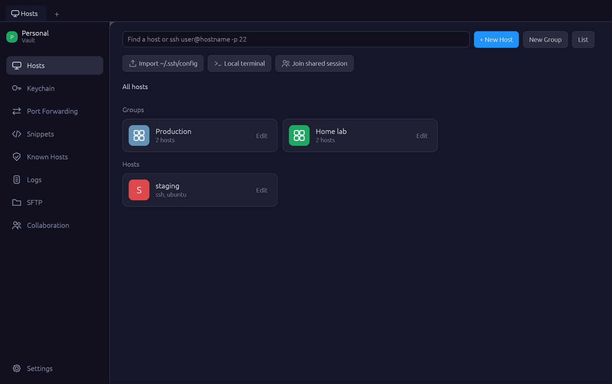
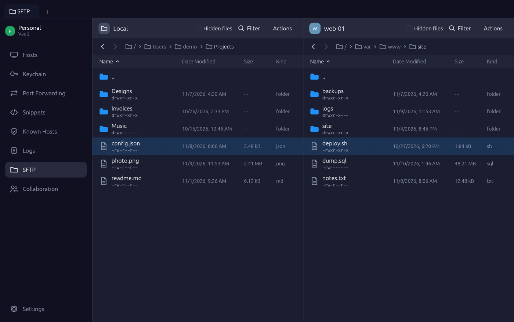

# SSHTUP

An SSH client with self-hosted sync.

A native desktop SSH client written in Rust ([egui](https://github.com/emilk/egui)), with an optional
sync server you host yourself.

- Hosts, groups, keychain, snippets, port forwarding, known hosts, session logs
- SFTP browser with two panes, host to host transfers and path autocomplete
- Command history and autocomplete
- Optional master password: the vault, logs and history are encrypted (Argon2id + XChaCha20-Poly1305)
- **Sync** between your devices through your own server, end-to-end encrypted: the server only stores sealed data
- **Teams**: share a host or a whole group with other people on the same server
- **Shared terminals**: let someone watch (and, if you allow it, type into) a terminal, end-to-end encrypted. Everyone sees who is in the session and who is typing





## Install

Download the package for your system from the [latest release](https://github.com/tonihardianto/sshtup/releases/latest).
`SHA256SUMS.txt` lists the checksum of every file.

The packages are **not signed or notarized** yet, so macOS and Windows warn about them the first
time. That is expected; the steps below get past it.

### macOS

Use the `.dmg` (or the `.zip`) that matches your Mac: `arm64` for Apple silicon, `x86_64` for Intel.
Drag **SSHTUP** to Applications.

macOS will say it cannot verify that SSHTUP is free of malware. To open it anyway:

1. Try to open the app once and press **Done**.
2. Open **System Settings → Privacy & Security**, scroll to **Security**, and press **Open Anyway** next to "SSHTUP was blocked". Enter your password.

Or remove the quarantine flag in a terminal:

```bash
xattr -dr com.apple.quarantine /Applications/SSHTUP.app
```

### Windows

Run `sshtup-setup-windows-x86_64.exe` (per-user install, no administrator rights needed), or use
the portable `sshtup-windows-x86_64.exe` and run it from anywhere.

If SmartScreen shows "Windows protected your PC", press **More info → Run anyway**.
SSHTUP runs the system `ssh`, `sftp` and `ssh-keygen`, so install the OpenSSH client
(Settings → Apps → Optional features) if you do not have it. See [PLATFORMS.md](PLATFORMS.md) for what is still missing on Windows.

### Linux

- **Debian / Ubuntu:** `sudo apt install ./sshtup-linux-x86_64.deb`
- **AppImage:** `chmod +x sshtup-linux-x86_64.AppImage && ./sshtup-linux-x86_64.AppImage`
- **Any distribution:** unpack `sshtup-linux-x86_64.tar.gz` and run `sshtup`

The packages are built on a recent Ubuntu; older distributions may lack a newer system library.

### Sync server

`sshtup-sync-server-linux-x86_64.tar.gz` is the optional server. See [SYNC.md](SYNC.md).

## Build

```bash
cargo build --release --bin sshtup          # the desktop app
cargo build --release -p sync-server               # the sync server (optional)
```

On Linux the window toolkit needs a few system libraries; see `.github/workflows/ci.yml`.
Platform status is in [PLATFORMS.md](PLATFORMS.md).

## Self-hosting

- [SYNC.md](SYNC.md): run the server, TLS, backups, teams, what the server can and cannot see
- [RELAY.md](RELAY.md): shared terminals (the relay built into the server)
- `deploy/`: helper scripts

## Status

Early software. The encryption design has not had an independent review: read [SYNC.md](SYNC.md)
before trusting it with anything important.

## License

[MIT](LICENSE). The colour schemes other than "Default Dark/Light" are community themes
(Dracula, Solarized, Nord, Gruvbox, Catppuccin and others) that belong to their authors.
